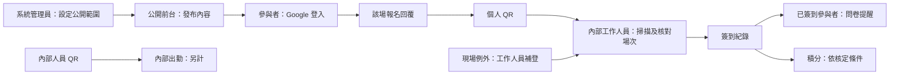

# 拼圖聯盟 OS｜參與者前台與活動流程架構草案

2026-11-07 · 設計基線 `1920725` · `project-puzzle-union` revision 27

## 已確認的產品行為

- 聯盟參與者用 Google 登入，毋須建立站內帳密。參與者與內部六層角色的帳號、資料和權限分開；即使信箱相同也不串接。
- **簽到表以該場活動的報名名單為準。** 報名完成顯示個人 QR，登入前台可再開啟 QR 頁，由工作人員掃描。未事先報名者保留現場工作人員的處理入口。內部人員也有個人簽到 QR，出勤另外統計。
- 活動負責人只對已簽到的參與者發問卷，參與者登入後收到填寫提醒，後台可看填寫進度。依帳號統計參與、出席和滿意度，另外看整體回流。
- 參與活動、課程及貢獻可得分，內部人員也累積積分。內部一般成員以上以協助辦活動得分為主，參與給分較少。系統管理員可調整各活動或課程的給分，積分目前無期限，預留未來兌換。
- **前台公開範圍由系統管理員在後台調整。** 需有訪客公開頁、登入後的參與者前台、內部預覽和活動紀錄照片。

來源為小高 2026-11-06 設計筆記（第二大腦 `_agent-inbox/2026-11-06-puzzle-union-participants-checkin-points-design-xiaogao.md`）與本對話對簽到及公開設定的補充。以下資料模型、路徑與操作方式均為提案。

## 既有系統與改動接點

| 現有責任 | 程式現況 | 設計接點 |
| --- | --- | --- |
| 內部登入 | [admin-auth.ts](../app/admin-auth.ts) 的 `getMember()` 從 `puzzle_admin_session` 讀取啟用中的 `members`；[`/` 入口](../app/page.tsx) 分流內部登入與 Workspace。 | 另設參與者前台與 session，沿用內部 session 驗證工作人員。 |
| 活動與職權 | [workspace API](../app/api/workspace/route.ts) 將活動和逐場授權放在有版本的 `workspace_states.data`；[內部報名 API](../app/api/registration-forms/route.ts) 另核對逐場職權，見習總召目前拿不到報名答案。 | 沿用活動 ID，新增逐場掃碼／補登能力；驗證操作者的職權及目標活動。 |
| 報名 | [公開報名 API](../app/api/public/registrations/%5Bslug%5D/route.ts) 可匿名提交、檢核表單及同意，依表單與送出識別碼去重。[D1 schema](../db/schema.ts) 的回覆有表單 ID 和版本，無參與者帳號欄位。 | 沿用表單與回覆。新增受驗證的身分連結，既有報名回覆仍能查閱，不以信箱或姓名猜測帳號歸屬。 |
| 系統設定與發布 | [設定面板](../app/settings-panel.tsx) 目前有帳號、同步、權限及稽核。共用版跑 Worker／D1，GitHub Pages 入口不執行共用 API。 | 管理員從後台新增前台公開設定，對外內容走專用讀取介面。 |

## 提議架構

前台分為訪客與參與者兩個入口。參與者登入後先看可用的簽到 QR，並可從同一前台看自己的報名、問卷提醒與積分。工作人員從現有內部系統進入當場簽到。三方共用活動 ID，仍各自使用所需的資料和權限。

| 邊界 | 候選資料與約束 |
| --- | --- |
| 參與者帳號 | `participants`（站內 ID、Google `sub` 唯一鍵及必要聯絡欄位）和 `participant_sessions`。伺服器驗證 Google ID token 的簽章、發行者、對象、效期與登入流程綁定；`sub` 用來辨識帳號，站內發獨立 session。Google 帳號資料不賦予內部角色。 |
| 報名與名單 | 透過新增關聯將 `registration_submissions.id` 與已驗證的 `participant_id` 綁定，正常路徑以一場、一人一筆有效報名為候選約束。保留表單版本、原回答、繳費及既有公開連結。舊報名無可靠證明時仍留在原名單，交由工作人員處理個案。 |
| 掃碼與出勤 | 參與者簽到依報名回覆與場次核對；建議用無個資、可撤銷的隨機 QR 代碼，後端保存雜湊並驗證場次、資格與工作人員權限。成功寫入保存時間、操作者、來源，對同場同一有效報名重掃回傳原結果。內部人員的 QR 解析為內部 ID，另寫內部出勤。 |
| 現場例外 | 建議已登入但未報名者由具該場權限的工作人員走「現場補登」，先建立標記來源的報名，再完成簽到，套用同場去重；保留操作者及原因。舊報名者找不到 QR 時可由工作人員核對該場既有報名後協助。沒有可驗證帳號的例外先留待核對，不自動配對，也不自動產生問卷或帳號積分。 |
| 問卷 | `surveys`、`survey_recipients`、`survey_responses` 按活動與發布版本隔離。發放時依有效簽到產生收件名單；提交時再查帳號、收件資格及簽到有效性。一人一份，送出可重試。建議見習總召沿用可編輯表單、不可看個別答案的界線，填寫進度只顯示授權範圍。 |
| 積分 | `point_rules` 由系統管理員設定，`point_entries` 以參與者與內部兩種身分類別獨立記帳。建議保留分值、規則版本、事件、操作者和原因，來源事件唯一以防重複發分。調整分值只適用後續入帳，已入帳需更正時另記沖銷；兌換延後。 |
| 公開內容與照片 | 以活動 ID 管理發布內容和可見範圍，從後台調整公開／登入後可看／內部預覽。公開 API 僅輸出允許的欄位與照片，不讀出整份 workspace 或報名回覆。公開預覽使用與訪客相同的欄位規則；未發布預覽仍需內部權限，照片直連與快取一併套用發布規則。 |

報名回覆和參與者連結應一起提交，或可用同一請求識別碼安全恢復。兩者都寫入後才顯示 QR。正常報名與現場補登同時發生時，使用相同的場次與參與者唯一約束，回傳既有報名結果。

活動目前存在 JSON 中，先透過既有活動讀取及授權邏輯驗證活動存在與權限，無需把活動整批搬表。若日後刪除已有報名或出勤的活動，需先定義封存與資料保留方式。新紀錄以增量 migration 加入，試行使用隔離 D1 與獨立開關。必要時關閉新入口並保留試行紀錄供核對。

## 建議實作順序與驗收

| 階段 | 可交付的流程 | 需要看到的結果 |
| --- | --- | --- |
| 1. 參與者與簽到 | 用一場試辦活動串起 Google 登入 → 報名 → 個人 QR → 工作人員掃描，含現場例外與內部 QR。 | 同信箱的兩個身分仍分開；一般掃碼只認該場有效報名；錯場、撤銷碼或無權工作人員被拒絕；雙裝置同時掃描只產生一次簽到；現場補登可追溯；舊連結及內部權限仍可用。 |
| 2. 公開前台 | 後台可調整活動資訊與照片發布，內部可預覽。 | 同一活動切換設定後，以匿名、參與者與內部三種身分驗證頁面、API 和照片網址。舊報名連結在未明確變更其設定前維持現行開放規則；上線前需驗收「隱藏前台」與「關閉既有報名」各自的作用。 |
| 3. 問卷與統計 | 依簽到發問卷，登入後提醒，提供逐場填寫進度與統計。 | 有報名未簽到者看不到或送不出問卷；發放重試不重複；內部出勤不混入參與者統計。回流率暫以選定期間內出席至少兩場的帳號／出席過的帳號作為候選定義。 |
| 4. 積分 | 管理員設定活動／課程規則，按核定的參與或貢獻事件記帳。 | 兩類身分分開，重試不重複發分，變更規則不追改歷史，沖銷有原因且可追溯。 |

待定事項按階段解決。第一階段需要落定首次 Google 登入入名單方式，以及現場補登與舊報名核對所需欄位；可先以首次登入建帳、當場由工作人員確認為草案假設。正式架設位置、網域和 Google 回呼設定在試辦前確認。問卷補發與個別答案權限在第三階段收斂；積分觸發時點、總召手動貢獻分的上限和核准規則在第四階段收斂。

實作時應按階段另定檔案與授權範圍，特別是 session、API、D1 migration 和後台接點。先在隔離 D1 用現行內部登入、導覽、報名和角色權限作回歸基準，再加入每階段的正反例。

Google 登入設計依據：[Google OpenID Connect](https://developers.google.com/identity/openid-connect/openid-connect)。
